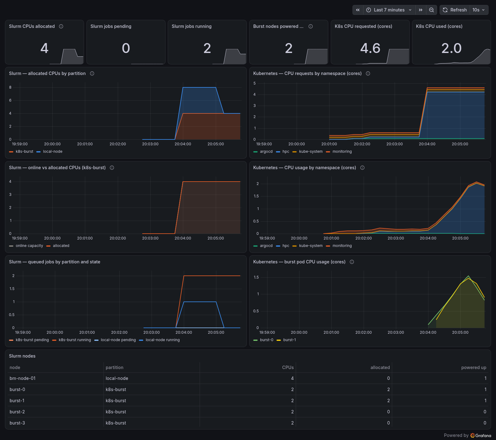
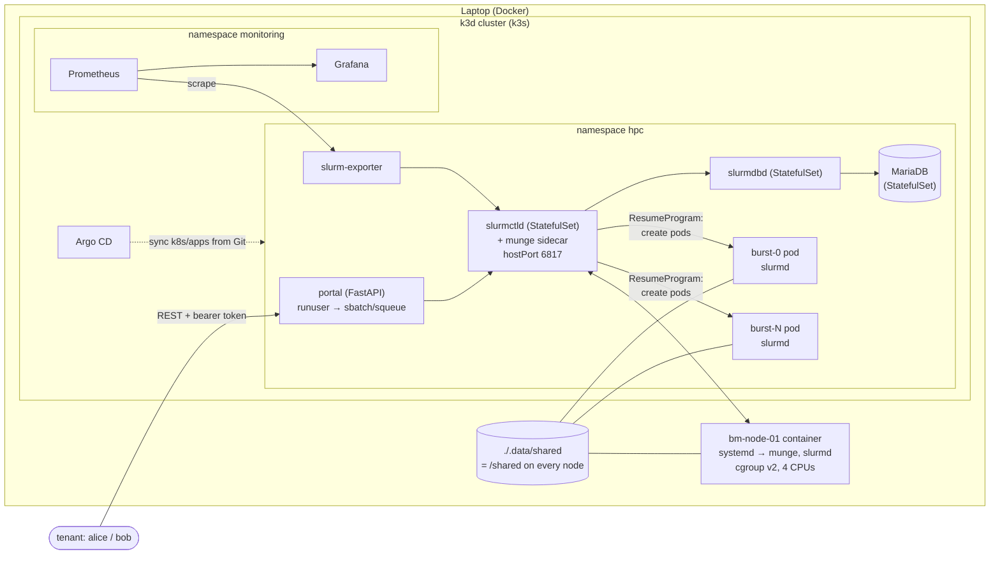

# hpclab — a hybrid HPC + Kubernetes cluster on one laptop

A Slurm cluster whose control plane runs in Kubernetes. Its compute nodes are split across two partitions:

- **`local-node`**: a Docker container emulating a bare-metal server. It runs systemd as PID 1, a munge service, and a `slurmd` that enforces cgroup v2 limits on every job.
- **`k8s-burst`**: elastic capacity. When jobs queue for this partition, Slurm's power-saving hooks create Kubernetes pods that join the cluster as compute nodes, and delete them once they have been idle.

Tenants submit work through a REST API that runs each job as their own POSIX user. Prometheus and Grafana show Slurm's CPU allocation side by side with Kubernetes CPU requests and usage. Argo CD can deploy everything above the platform layer from Git.



## Architecture



| Layer | What it is | Where |
|---|---|---|
| Virtual bare metal | Ubuntu 26.04 container with systemd, `munge.service`, `slurmd.service` (configless), a first-boot provisioning unit, cgroup v2 delegation, cpuset `0-3`, 2 GiB | `infra/baremetal/` |
| Kubernetes | k3d (k3s v1.35) on a dedicated Docker network shared with the bare-metal node | `infra/k3d/` |
| Slurm control plane | `slurmctld`, `slurmdbd` and MariaDB as StatefulSets with munge as a native sidecar, plus an accounting bootstrap Job | `k8s/apps/slurm/` |
| Burst capacity | Slurm `State=CLOUD` nodes backed by pods that the power-save hooks create and delete | `infra/images/slurm/bin/k8s-power`, `k8s/apps/slurm/config/` |
| Microservice | FastAPI job portal + Prometheus exporter (one Python package, two entrypoints) | `app/`, `k8s/apps/portal/` |
| Observability | kube-prometheus-stack, ServiceMonitor, provisioned dashboard | `k8s/platform/`, `k8s/apps/observability/` |
| GitOps | Argo CD with one Application per workload directory | `k8s/argocd/` |

Software: Slurm 25.11, munge 0.5.16, k3s v1.35.5, kube-prometheus-stack 91.9.0, Argo CD 3.5 (chart 10.9.6), Python 3.14, FastAPI.

## Quick start

Requirements: Linux with Docker and **cgroup v2** (the default on current distributions), about 6 GB of free RAM, at least 4 CPUs, and outbound internet for images and Helm charts. `kubectl`, `helm` and `k3d` are downloaded as pinned versions into `./.tools/bin`; nothing is installed system-wide, and `~/.kube/config` is never touched.

```bash
make up      # tools, .env with random secrets, images, cluster, platform, Slurm, portal, bare-metal node (~4 min cold)
make demo    # submit jobs through the API and watch both partitions run them
make status  # Slurm nodes and queue, pods, systemd units on the bare-metal node
make down    # remove everything (make clean also deletes the shared filesystem)
```

| Endpoint | URL | Credentials |
|---|---|---|
| Job portal (OpenAPI docs) | http://localhost:30080/docs | `Authorization: Bearer <token>` from `PORTAL_API_TOKENS` in `.env` |
| Grafana | http://localhost:30300 | Dashboards open read-only without login; admin password is `GRAFANA_ADMIN_PASSWORD` in `.env` |
| Prometheus | http://localhost:30090 | none |
| Argo CD | http://localhost:30808 | `admin` / `make argocd-password` |

Every port is bound to `127.0.0.1` only.

### Using the API

```bash
set -a; source .env; set +a
TOKEN=$(tr ',' '\n' <<<"$PORTAL_API_TOKENS" | sed -n 's/^alice://p')

curl -s -X POST localhost:30080/submit-job -H "Authorization: Bearer $TOKEN" \
  -H 'Content-Type: application/json' \
  -d '{"name":"hello","partition":"k8s-burst","cpus":2,"mem_mb":512,"command":"hostname; nproc"}'
# {"job_id":1,"user":"alice","partition":"k8s-burst","output":"/shared/home/alice/slurm-1.out","status_url":"/job-status/1"}

curl -s localhost:30080/job-status/1 -H "Authorization: Bearer $TOKEN"
```

| Method | Path | Purpose |
|---|---|---|
| `POST` | `/submit-job` | Submit a batch job (`name`, `partition`, `command`, `cpus`, `mem_mb`, `time_limit_min`) as the token's user |
| `GET` | `/job-status/{id}` | Live state from `squeue`, or from `sacct` once the job has left the queue; 404 for other tenants' jobs |
| `GET` | `/jobs` | The caller's queued and running jobs |
| `GET` | `/cluster` | Per-partition node, CPU and power-state summary |
| `GET` | `/healthz`, `/readyz` | Liveness, and readiness (`scontrol ping`) |

Slurm rejections such as "More processors requested than permitted" come back as `400`. An unreachable controller returns `503`. Every response carries an `X-Request-ID` that also appears in the portal's JSON logs.

## Demo recording

`docs/demo.cast` is an [asciinema](https://asciinema.org) recording of `make demo` on a freshly built lab:

```bash
asciinema play docs/demo.cast
```

The recording shows, in order:

1. Jobs submitted via the REST API by two tenants.
2. Slurm creating burst pods, registering their addresses, and running jobs on the bare-metal node and in pods at the same time.
3. Cross-tenant isolation at the API, Slurm, and filesystem levels.
4. Job output written by the tenant's UID to the shared filesystem.

Open Grafana while the demo runs to watch the dashboard above update live.

## How it works

### Virtual bare-metal node

`hpclab/baremetal` boots `/sbin/init`. Units that make no sense in a container (udev, getty, logind) are masked. Boot order is enforced with unit dependencies:

1. `hpc-node-init.service` (oneshot) reads `MUNGE_KEY_B64` from PID 1's environment, because systemd does not pass a container's environment to its units. It installs the key as `munge:munge 0400`, checks that the controller resolves, and lays out `/shared`.
2. `munge.service` and then `slurmd.service` start, with drop-ins adding `Requires=`/`After=` and unlimited restarts.
3. slurmd runs in **configless** mode (`--conf-server slurmctld:6817`), so the node never keeps its own copy of `slurm.conf` and cannot drift from the controller.

The container is privileged with a private cgroup namespace, so systemd owns a real cgroup v2 tree. slurmd asks systemd over D-Bus for a delegated `slurmstepd.scope`, and each job lands in `/system.slice/bm-node-01_slurmstepd.scope/job_<id>/` with `cpuset.cpus` and `memory.max` set from its allocation.

**Shared storage and identity.** `./.data/shared` is bind-mounted as `/shared` into the bare-metal container and into the k3d node, where pods use it via `hostPath`. All images derive from one base image that creates the service accounts and tenants with fixed IDs (`munge` 980, `slurm` 981, `alice` 2001, `bob` 2002, groups `hpcusers`/`physics`/`chemistry`). File ownership therefore means the same thing on every node.

| Path | Ownership and mode | Purpose |
|---|---|---|
| `home/<user>` | the user, `0700` | Private tenant home |
| `projects/<account>` | the account's group, `2770` (setgid) | Shared project space |
| `scratch` | `1777` (sticky) | Scratch space |

### Slurm control plane in Kubernetes

- `slurmctld`, `slurmdbd` and MariaDB are single-replica StatefulSets with PVCs (k3s `local-path`). Each Slurm pod runs munged as a **native sidecar** (`initContainers` with `restartPolicy: Always`) behind a startup probe that mints and verifies a credential. The main container therefore never starts without authentication.
- The headless Services set `publishNotReadyAddresses: true`. Slurm daemons, and slurmctld's own readiness probe (`scontrol ping`), resolve each other by name, so DNS must exist *before* readiness.
- `slurmdbd.conf` is rendered at start-up from a template plus a Secret-backed environment variable. The database password exists only in the Secret and in a `0600` file in the container.
- The controller waits for slurmdbd before starting, because with `AccountingStorageEnforce` set it exits fatally if accounting is unreachable.
- slurmctld publishes `hostPort: 6817`, so the bare-metal container reaches it at the k3d node's Docker address. `up.sh` injects that address as `slurmctld` into the container's `/etc/hosts`.
- The node networks (Docker bridge vs. pod CIDR) are not mutually routable, so `TreeWidth=65533` makes slurmctld contact every node directly rather than relaying messages through other slurmds.
- Accounting has two tenants in separate accounts (`alice`→`physics`, `bob`→`chemistry`) with multifactor/fair-share priority. `PrivateData=jobs,usage` is set in **both** `slurm.conf` and `slurmdbd.conf`, because finished jobs are served by slurmdbd, which ignores the controller's setting.
- `EnforcePartLimits=ALL` rejects impossible requests (e.g. 16 CPUs on 2-CPU nodes) at submit time instead of leaving them pending forever.

### Cloud bursting onto Kubernetes

`burst-[0-3]` are declared `State=CLOUD`, so they start powered down (`idle~`). When jobs need them:

1. slurmctld runs `ResumeProgram=/opt/hpc/bin/k8s-resume burst-[0-1]`. It uses only the Python standard library and talks to the Kubernetes API with the controller's ServiceAccount, scoped by a Role to pods in `hpc`.
2. The hook renders one pod per node from `burst-pod.json`, a ConfigMap kept in Git. Each pod is privileged and has a munge sidecar, `requests == limits` of 2 CPU / 1 GiB, and `/shared` mounted.
3. It waits for each pod IP and registers it with `scontrol update nodename=burst-0 nodeaddr=<podIP>`. Since Slurm 24.x, whoever powers up a cloud node is responsible for telling Slurm its address.
4. slurmd starts with `-b` (report "booted now"). A container reports the host kernel's boot time, which is always older than the resume request, so without `-b` slurmctld would wait for a reboot that never happens.
5. After `SuspendTime=90` seconds idle, `SuspendProgram` deletes the pods. If a node fails to come up within `ResumeTimeout`, `k8s-resume-fail` deletes its pod, and Slurm requeues the job. The hook then returns the node to the powered-down pool instead of leaving it `DOWN`.

**cgroups inside the burst pods.** Privileged pods share the node's cgroup namespace, and Slurm roots its hierarchy at `dirname(cgroup of PID 1)`. So the entrypoint moves PID 1 into `<container-cgroup>/init` and delegates controllers on the container cgroup. Job cgroups then nest *inside* the pod's limits: `…/<container>/system.slice/burst-0_slurmstepd.scope/job_<id>`. Memory is enforced per job. Core pinning is deliberately disabled on burst nodes: every pod sees the host's full CPU list, so Slurm would pin every burst job to physical cores 0..N-1. In testing that cut CPU efficiency to 42%; it is 95% with the pod's CFS quota providing CPU isolation instead.

Burst pods carry no Argo CD tracking label, so runtime scaling never shows up as drift (verified against a live sync).

Watch scaling as it happens with `make logs`; the hook's JSON logs are tailed into slurmctld's stdout.

### Job portal

FastAPI in `app/hpc_portal/`. Requests authenticate with per-tenant bearer tokens (constant-time compare). The token, never the request body, determines the POSIX user. The service runs Slurm commands through `runuser -u <tenant>`, so munge credentials, accounting associations, PrivateData visibility and file ownership all follow the tenant's real UID.

The container runs as root only so that `runuser` can switch users. Every capability except `SETUID`/`SETGID`/`AUDIT_WRITE` is dropped, privilege escalation is disabled, and the root filesystem is read-only. A defense-in-depth check returns 404 if a job's owner differs from the caller, even if PrivateData were ever misconfigured.

### Observability

`hpc_portal.exporter` runs as the `slurm` user, which is exempt from PrivateData without being root. A background thread polls `scontrol --json show nodes` and `squeue --json`, and the collector serves the last good snapshot, so a slow controller degrades freshness rather than failing scrapes. It exports:

- Node CPU and memory by allocation state, power state, and node state.
- Partition CPUs as `allocated`, `online` (powered-up capacity), `idle` and `total`.
- Jobs and CPUs by partition, state and account.
- Its own health: last success timestamp, poll duration, and errors.

The Grafana dashboard (generated by `scripts/gen-dashboard.py`) puts Slurm on the left and Kubernetes on the right:

- allocated CPUs by partition vs. CPU requests by namespace
- burst capacity online vs. allocated vs. CPU usage by namespace
- queue depth vs. per-burst-pod usage
- a node table at the bottom

### GitOps

The platform layer (Argo CD itself and kube-prometheus-stack) is installed by Helm with the pinned values in `k8s/platform/`. Everything under `k8s/apps/` is plain Kustomize and can be delivered two ways:

- **Direct (default).** `make up` runs `kubectl apply -k` for each app.
- **GitOps.** Push this repository to a public Git host and set `GITOPS_REPO_URL=https://github.com/<you>/<repo>.git` in `.env`, then run `make up`. It applies the three Applications in `k8s/argocd/applications/` with automated sync, prune and self-heal. The accounting bootstrap Job runs as an Argo CD `PostSync` hook.

Secrets never live in Git. `make up` creates them from `.env` (`munge-key`, `slurm-db`, `portal-tokens`, `grafana-admin`); in a shared environment they would come from Sealed Secrets or External Secrets.

## Verification checklist

| Claim | How to check |
|---|---|
| Bare-metal node is systemd-managed | `docker exec bm-node-01 systemctl status slurmd munge hpc-node-init` |
| Jobs are cgroup-confined | Job output prints `/proc/self/cgroup`; inside a job `cat /sys/fs/cgroup$(sed -n 's/^0:://p' /proc/self/cgroup)/../memory.max` matches `--mem` |
| Burst pods appear and disappear | `kubectl -n hpc get pods -w` while running `make demo`; `make slurm CMD="sinfo -N"` shows `idle~` → `alloc` → `idle%` → `idle~` |
| Tenant isolation | bob's token on alice's job → 404; `docker exec bm-node-01 runuser -u bob -- ls /shared/home/alice` → permission denied |
| Accounting | `make slurm CMD="sacct -a -X -o jobid,user,account,partition,nodelist,alloccpus,totalcpu,state"` |
| Config rollout | edit `k8s/apps/slurm/config/slurm.conf`, then `make reconfigure` (applies the ConfigMap, waits for the kubelet to sync it, runs `scontrol reconfigure`, which also pushes to configless nodes) |
| Unit tests | `make test` (parsers are tested against JSON captured from a live Slurm 25.11 cluster) |

## Repository layout

```
infra/
  images/slurm/       Base image + entrypoints (munge sidecar, slurmctld, slurmdbd, burst slurmd, power-save hook)
  baremetal/          systemd node image, units and drop-ins, first-boot provisioning, docker-compose.yml
  k3d/cluster.yaml    Cluster definition (network, shared volume, localhost-only ports)
k8s/
  platform/           Pinned Helm values + chart versions (kube-prometheus-stack, Argo CD)
  apps/slurm/         StatefulSets, RBAC, accounting Job, slurm.conf / cgroup.conf / burst pod template
  apps/portal/        Portal (NodePort 30080) and exporter Deployments
  apps/observability/ ServiceMonitor + Grafana dashboard
  argocd/applications/ Argo CD Applications for the three app directories
app/                  FastAPI portal + exporter, Dockerfile, tests with real Slurm fixtures
scripts/              up / down / demo / status / reconfigure / build-images, shared JSON logging helpers
docs/                 Dashboard screenshot and demo recording
```

All scripts and Python services log one JSON object per line, with `timestamp`, `level`, `context`, `message` and, on failure, `error` and `stack`. The API also logs `request_id`, and the power-save hook logs a `trace_id` per invocation. Required secrets are validated at start-up, and the services refuse to run without them.

## Security notes (lab vs. production)

- The bare-metal container and burst pods are **privileged**, because systemd and Slurm need to manage cgroups. On real hardware slurmd runs on the host. In Kubernetes, you would use a node pool dedicated to HPC with a restricted admission policy.
- The portal speaks plain HTTP on localhost. Put it behind an ingress with TLS, and replace static tokens with OIDC → POSIX-user mapping, before exposing it.
- Pod Security Admission is not enforced on the `hpc` namespace, because burst pods are privileged.

## Troubleshooting

| Symptom | Fix |
|---|---|
| `make up` fails creating the network | Another Docker network uses `172.28.0.0/24`; remove it, or change the subnet in `scripts/lib/common.sh`, the bare-metal address in `infra/baremetal/docker-compose.yml`, and `NodeAddr` in `slurm.conf` together |
| `bm-node-01` never registers | `docker exec bm-node-01 journalctl -u hpc-node-init -u slurmd`; the controller address is injected by `up.sh`, so start the node through `make up`, not `docker compose` directly |
| Burst node stuck `alloc#` / `down~` | `make logs` shows the power-save hook. Check `kubectl -n hpc describe pod burst-N`. A node that failed to boot returns to `idle~` automatically, and its job is requeued |
| Fewer than 4 host CPUs | Set `BAREMETAL_CPUSET` (e.g. `0-1`) before `make up`, and lower `CPUs=` for `bm-node-01` in `slurm.conf` |
| Need a clean slate | `make clean && make up` |
